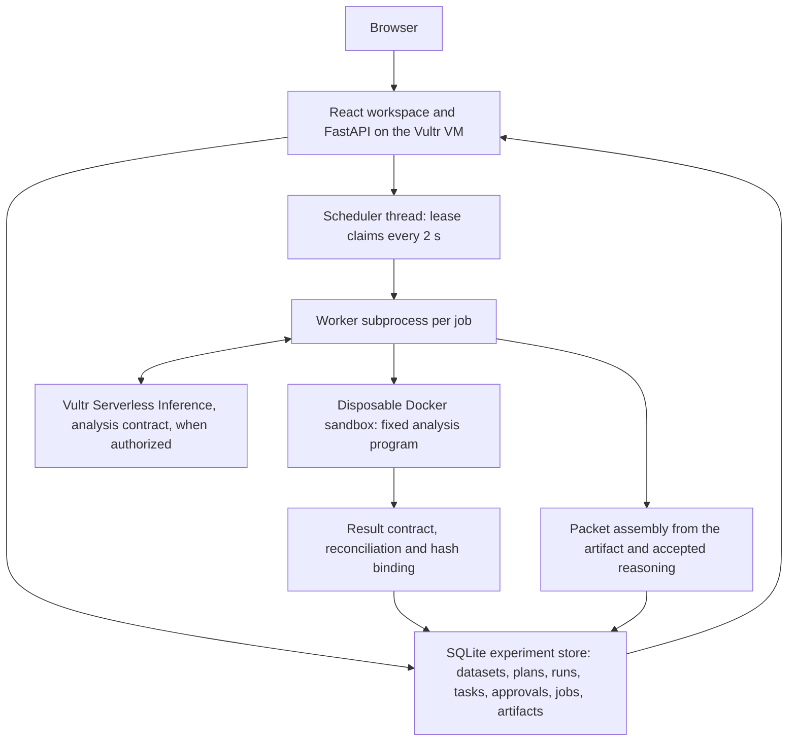

# SalesDesk

Demo URL (activation pending upstream firewall): https://salesdesk.149.28.51.139.sslip.io

Formerly ProofDesk. The app and repository are now SalesDesk. Existing Vultr resource
names, the local checkout path, service/install paths, `PROOFDESK_*` settings, session
cookies, request headers and execution labels retain their identifiers for compatibility.
Historical records and authorization references remain unchanged.

[](https://github.com/Jsjk112344/salesdesk/actions/workflows/ci.yml)

SalesDesk helps a sales team use evidence, statistics and AI reasoning to choose an
improvement, approve the next action, run scheduled work on a Vultr VM and measure the result,
all inside one workspace. The first complete experiment answers a sales manager's question on
a genuine public dataset: **did these e-mails create additional purchases, and what should we
test next?** It reproduces a historical randomized e-mail campaign, then prepares an approved
next-experiment packet through a durable scheduled job.

**Status: experiment workspace implemented, verified locally with real Docker execution on the
genuine dataset, and privately deployed on the owner's Vultr VM** (see [STATUS.md](STATUS.md)
for the observed checkpoint). The interpretation step runs in **rule-based mode (no model)** by
default; live model mode is implemented behind a validated analysis contract but **no successful
live Vultr inference has been observed yet** for any contract, and the consolidated budget
proposal in [docs/inference.md](docs/inference.md) awaits authorization. Public activation is
prepared, not switched on. This is not yet a complete hackathon entry.

## Vultr Agent Rush

Selected challenge: **Powering the Future of Work**, November 3–8, 2026. The
[official event](https://lablab.ai/ai-hackathons/vultr-hackathon) asks for a realistic enterprise
workflow with a Vultr VM backend and web application, a public repository, demo URL and video.
For this challenge Vultr Serverless Inference and sandboxing are **optional**; SalesDesk uses
Vultr inference and sandboxed execution as its own engineering choices. Vultr owns the API, the
durable workspace, scheduling, worker execution and results; the browser is a client, not the
scheduler. Submission is through LabLab; nothing has been submitted.

Original project code is [MIT licensed](LICENSE). No proprietary application code or private
customer data is included. [Provenance](docs/provenance.md) records the baseline;
[THIRD_PARTY.md](THIRD_PARTY.md) covers dependencies, the dataset's rights boundary and references.

## What a sales manager can do

1. **Open the historical campaign dataset** and read its provenance: publisher, download and
   checksum sources, the three original arms with customers, visits, purchases and spend, the
   validation checks and the documented limitations. Raw rows are never shown or served.
2. **Save an analysis plan**: a fixed comparison of two original arms (Mens E-Mail versus No
   E-Mail by default; the third arm stays visible but excluded), fixed outcomes and intervals,
   bootstrap seed and resamples, and pre-declared exploratory breakdowns.
3. **Run the statistics on the server.** "Run now" queues a job that the API's scheduler claims
   under a lease and executes in the disposable Docker sandbox with the fixed, versioned analysis
   program. Counts and spend are reconciled against the importer's independent Decimal
   aggregates; Wilson and Newcombe intervals are recomputed by the controller; hashes bind the
   dataset, plan, program and artifact. Repeat runs reproduce the identical artifact.
4. **Inspect conversion, visits, incremental historical revenue and uncertainty** with every
   chart carrying its denominator, definition, interval method and artifact provenance, plus a
   labelled interpretation: rule-based by default, or the Vultr model under contract when
   authorized (numbers are rendered in code from validated metric ids; a failed live step is shown
   as failed and never replaced).
5. **Edit and approve the proposed next experiment**: hypothesis, variants, audience
   requirements, unit of randomization, primary outcome, observation window, decision rule and
   missing inputs, plus entered scenario assumptions (audience size, margin, cost) and sample-size
   inputs that stay visually separate from measurements. Approval binds to the exact proposal and
   artifact hashes; editing invalidates it.
6. **Assign an internal task and schedule preparation**, close the browser, and come back to a
   durable packet: the worker validates the approval, assembles the packet from the real
   artifact and accepted reasoning (no model call), reports missing inputs rather than inventing
   them, and leaves a downloadable Markdown packet for human review. The queue shows awaiting
   approval, scheduled, running, ready for review, completed, cancelled and failed work, with
   attempts and failures preserved.

The prospect workspace (offering + prospect website → sourced brief → demonstration decision →
sandboxed demonstration → unsent draft → version-bound review) remains available under
**Prospects** as a supporting route for a future prospective experiment.

[docs/experiments.md](docs/experiments.md) records the dataset, importer, formulas, provenance,
licensing boundary and limits; [docs/demo-walkthrough.md](docs/demo-walkthrough.md) is the
walkthrough around the actual product.

### What the controller checks, and what it does not

| Mechanism | What it establishes | Limitation |
| --- | --- | --- |
| Pinned import: exact byte count and SHA-256, header, domains, finite non-negative currency, binary outcomes; malformed values stop the import | The analysed rows are the published file, typed, with multiplicity preserved | Random assignment is as described by the publisher and is not independently verifiable here |
| Sandbox result contract and reconciliation: counts and cents must equal the importer's Decimal aggregates; intervals must equal the controller's implementation; hashes must bind data, plan, program and input | A number shown traces to a validated artifact produced by the versioned program on the exact input | It establishes computation integrity, not that the historical study answers a present-day question |
| Interpretation contract: numbers only through `[metric:ID]` placeholders rendered in code; raw digits, ROI/profit wording, unknown ids and actions against the historical records are refused | A model cannot invent a figure, promise an outcome or propose contacting the anonymous records | Lexical checks; a grounded but wrong reading can still pass, which is why provenance and alternatives are shown |
| Version-bound approval: proposal hash + artifact hash + plan hash; stale approvals are refused by the worker | Prepared packets correspond to what a person approved | It does not make the packet a launch or the review complete |
| Durable jobs: atomic lease claims, conditional writes, unique artifacts per job, one bounded requeue | Work survives browser closure and a worker restart without duplicate results | Bounded by the quotas; a job can still end failed, which is recorded |
| Prospect checks (quotation, grounding, quantity attribution, savings wording, demonstration validation) | Unchanged from the prospect workspace | Lexical, not semantic; see docs/architecture.md |

## Local setup

Prerequisites: Python 3.12, [uv](https://docs.astral.sh/uv/), Node.js 24 and npm. Docker
is required for the analysis and demonstration sandbox. No API key or cloud account is needed
for the rule-based workspace.

```bash
git clone https://github.com/Jsjk112344/salesdesk.git
cd salesdesk
uv sync --locked
npm --prefix frontend ci
docker info
docker pull "$(cat infra/task-image.txt)"
```

Acquire and import the dataset (bounded, checksum-verified; the raw file stays in ignored
`.local/` and is never committed or served):

```bash
uv run python -m backend.app.experiments fetch     # or place the pinned CSV at .local/data-research/hillstrom/hillstrom.csv
uv run python -m backend.app.experiments import
uv run python -m backend.app.experiments status
```

## Run the workspace

Terminal 1, from the repository root:

```bash
uv run uvicorn backend.app.main:app --host 127.0.0.1 --port 8000 --workers 1
```

Terminal 2:

```bash
npm --prefix frontend run dev
```

Open http://127.0.0.1:5173. Build with `npm --prefix frontend run build` to serve the
compiled app from http://127.0.0.1:8000 instead; restart the API after building. API
documentation is at http://127.0.0.1:8000/docs. Keep **one API worker**: it hosts the job
scheduler thread that claims due jobs every two seconds and launches one worker subprocess at a
time. `uv run python -m backend.app.experiments worker --once` runs due jobs from a terminal
without the API.

Anonymous session cookies scope every plan, run, task, job and artifact; another session
receives 404. Records live under ignored `.local/experiments/` (`PROOFDESK_EXPERIMENT_STORE`),
sandbox executions under `.local/executions/`, and prospect records under `.local/prospects/`
(`PROOFDESK_PROSPECT_STORE`). Private limits per session: 10 plans, 20 runs, 20 tasks, 5 queued
jobs, due times up to 30 days ahead; public demo mode lowers them to 3 / 6 / 6 / 3 and 24 hours.
The prospect quotas are unchanged (one job at a time, five per session, `PROOFDESK_WEB_MAX_PROSPECTS`
total). These variables are documented here because the session's permission policy refuses
edits to `.env.example`:

| Variable | Meaning |
| --- | --- |
| `PROOFDESK_EXPERIMENT_STORE` | Directory for the SQLite store, dataset derivatives and artifacts (default `.local/experiments`) |
| `PROOFDESK_ANALYSIS_LIVE_PLAN` | Owner-approved plan file enabling live interpretation (with `VULTR_INFERENCE_API_KEY`) |
| `PROOFDESK_SALES_LIVE_PLAN` | Owner-approved plan file for the prospect contracts |
| `PROOFDESK_PUBLIC_DEMO`, `PROOFDESK_PUBLIC_LIVE`, `PROOFDESK_PUBLIC_URL_ALLOWLIST`, `PROOFDESK_WEB_MAX_PROSPECTS` | Public demo mode, as described in docs/public-demo.md |

Interpretation modes are labelled throughout the UI, records and packets:

| Mode | When | What it means |
| --- | --- | --- |
| Rule-based, no model | Default | Controller text built from interval positions of validated metrics. No model request. |
| Live model | Operator sets `PROOFDESK_ANALYSIS_LIVE_PLAN` to an owner-approved plan and provides `VULTR_INFERENCE_API_KEY` to the API | The Vultr model proposes the reading through the validated analysis contract; the controller renders every number. A failed request is shown as failed. |
| Saved replay | CLI only | A previously accepted live response replayed for identical requests. No request, no charge. |

The prospect endpoints (`/api/prospects`) and the extraction run endpoints (`/api/runs`) remain
for the supporting workflow and existing records.

## Operator CLI

```bash
uv run python -m backend.app.experiments import          # verify checksum, validate rows, derive the analysis input
uv run python -m backend.app.experiments status          # datasets, plans, jobs and tasks
uv run python -m backend.app.experiments worker --once   # run due jobs without the API
uv run python -m backend.app.sales run --sample harbor-vale-freight
uv run python -m backend.app.sales cleanup
uv run python -m backend.app.execution probe all
uv run python -m backend.app.execution cleanup
```

Live inference uses only Vultr's fixed HTTPS chat-completions endpoint. The original
two-request ledger is exhausted ($0.0040384 reserved under the $0.02 cap; both requests
failed validation). The consolidated proposal for the analysis contract (and, separately
approvable, the earlier prospect live-debug batch) is in [docs/inference.md](docs/inference.md);
no paid request is authorized until the owner approves it. Each plan binds model, deadlines,
token and byte bounds, request count, rates and cost cap in a durable local ledger that
reloading cannot reset, and actual usage is logged separately from reservations.

## Checks

```bash
uv run ruff check backend scripts
uv run ruff format --check backend scripts
uv run python -m compileall -q backend
uv run python -m unittest discover -s backend/tests -v
npm --prefix frontend run build
python3 scripts/check_repository.py
```

The offline suite covers the importer (exact counts, duplicate multiplicity, checksum, header,
domain, non-finite, negative, precision, binary and missing-value rejections), the published
Newcombe reference intervals and an independent Wilson root-finding check, the analysis program
through the controller with a test-only host runner (reconciliation, reproducibility, tampered
counts, timeouts, bad plans, oversized input), the interpretation contract (unknown metric,
raw numbers, ROI wording, historical-contact actions, malformed JSON), the full job/task journey
(approval binding, invalidation on edit, stale approval refused by the worker, duplicate dispatch,
lost leases, interrupted worker requeue and restart, cancellation, quotas, public limits,
cross-owner isolation, live failure preserving the result, budget exhaustion), the API surface,
and the earlier prospect, SSRF, contract, execution and generation checks. Six Docker test
methods are skipped unless enabled:

```bash
PROOFDESK_DOCKER_TESTS=1 uv run python -m unittest discover -s backend/tests -v
```

With Docker enabled, the analysis also runs in the real sandbox on the synthetic fixture and,
when the pinned file is cached locally, on the genuine dataset, checking reproducible artifact
hashes and verified cleanup.

A real-HTTP journey check (no mocks; optional controlled API restart during the analysis job)
records evidence under ignored `.local/`:

```bash
uv run python -m scripts.check_experiment_journey --output .local/live-preflight/journey.json \
  --restart-command "systemctl restart proofdesk"   # or a local restart command
```

UI interaction checks run in a disposable, network-disabled browser container against a
mocked API built from in-process journeys on the labelled synthetic fixture. They establish
interaction behaviour only, not retrieval, execution or inference:

```bash
docker build -t proofdesk-ui-check - < infra/browser-test.Dockerfile
uv run python -m scripts.check_browser
```

Screenshots and the bounded report stay ignored under `.local/browser/`.

## Architecture on Vultr



The web app, API, scheduler, workers, sandbox and store run on one Vultr Cloud Compute VM;
Serverless Inference is the only live model adapter. Credentials stay with the controller.
See [architecture](docs/architecture.md), [security boundaries](SECURITY.md),
[private deployment](infra/README.md), [data and method](docs/experiments.md),
[inference diagnostics and plan](docs/inference.md), [acceptance criteria](docs/acceptance.md),
the [forward plan](docs/plan.md), the [demo walkthrough](docs/demo-walkthrough.md) and the
[submission checklist](docs/hackathon.md).
