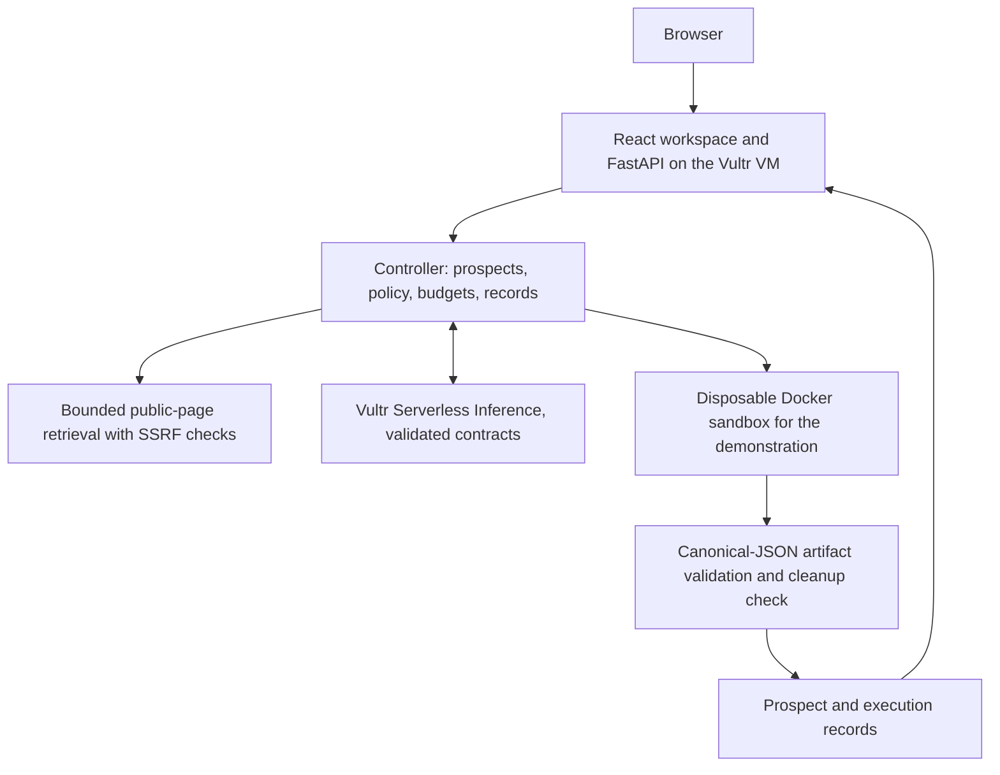

# SalesDesk

Formerly ProofDesk. The app and repository are now SalesDesk. Existing Vultr resource
names, the local checkout path, service/install paths, `PROOFDESK_*` settings, session
cookies, request headers and execution labels retain their identifiers for compatibility.
Historical records and authorization references remain unchanged.

[](https://github.com/Jsjk112344/salesdesk/actions/workflows/ci.yml)

A sales agent for technical sellers. Give it your offering and a prospect's website: it
researches a bounded set of public pages, separates dated facts from a labelled hypothesis,
decides whether its one supported technical demonstration is relevant, runs that
demonstration in a disposable sandbox when it is, and prepares an editable outreach draft
for a person to review. It never sends anything.

**Status: prospect workspace implemented and privately deployed on the owner's Vultr VM.**
The research → decision → demonstration → draft journey works end to end with real page
retrieval and real Docker execution in **rule-based mode (no model call)**. Live model mode
is implemented and tested offline against validated contracts, but **no successful live
Vultr inference has been observed yet**: the two earlier code-generation requests failed
validation and the approved budget is exhausted. A new live-validation plan is prepared and
awaits authorization. See [STATUS.md](STATUS.md). This is not a complete hackathon entry.

## Vultr Agent Rush

Selected challenge: **Powering the Future of Work**, November 3–8, 2026 (Online build
phase; on-site showcase November 8). The [official event](https://lablab.ai/ai-hackathons/vultr-hackathon)
asks for a realistic enterprise workflow with a Vultr VM backend and web application, a
public repository, demo URL and video. For this challenge Vultr Serverless Inference and
sandboxing are **optional**; SalesDesk uses Vultr inference and sandboxed execution as its
own engineering choices, not because the challenge requires them. Submission is through
LabLab; nothing has been submitted.

Original project code is [MIT licensed](LICENSE). No proprietary application code or
private customer data is included. [Provenance](docs/provenance.md) records the baseline;
[THIRD_PARTY.md](THIRD_PARTY.md) covers dependencies and references.

## What a salesperson can do

1. Enter **your offering** and a **prospect website**, or pick the clearly labelled
   synthetic sample scenario.
2. Read a short **prospect brief**: what the company demonstrably does, relevant facts quoted
   verbatim with source URL and capture time, a proposed opportunity labelled as a
   **hypothesis**, and the unknowns the pages do not establish.
3. See the **demonstration decision**: the supported document-extraction demonstration runs
   only when fetched pages cite document-handling work; otherwise it is skipped with the
   reason. When it runs, the workspace shows the verified result, what it actually proves,
   and the sandbox evidence.
4. Review an **editable draft** grounded in the cited facts and the demonstration outcome.
   Mark the exact version reviewed, copy it or download it as text. Editing creates a new
   version and clears the review. SalesDesk does not send email or connect to a CRM.

### Supported demonstration scope

The first demo is written for a technical seller offering **document-workflow automation**.
SalesDesk can demonstrate exactly one capability live: structured extraction from
semi-structured business documents, executed on labelled synthetic documents in a
disposable sandbox and validated against an expected answer. For other offerings it still
researches and drafts, but it does not pretend to demonstrate the product, and it never runs
anything on a prospect's own files. Three synthetic prospect sites under
[fixtures/prospects](fixtures/prospects/README.md) exercise the relevant, irrelevant and
insufficient-evidence paths.

### What the controller checks, and what it does not

SalesDesk links research to captured sources, checks demonstration outputs against
expected results, and presents outreach for human review. Each check is mechanical and
bounded; none of them establishes that a statement is true. The reviewer does that.

| Mechanism | What it establishes | Limitation |
| --- | --- | --- |
| Quotation check: every excerpt must be verbatim text of a fetched source with its URL and capture time | The quoted sentence really appears on that page | It does not establish that the page is accurate, or that an attached restatement means the same thing |
| Restatement grounding: a model claim's text may use only words and numbers from its own quotation (light stemming), else the response is rejected | An unrelated assertion cannot ride on a genuine quotation | Lexical, not semantic: word order or negation could still shift meaning, so the UI shows the quotation as the fact and labels the restatement |
| Quantity attribution: numerals, written numbers, quantifiers, percentages and amounts in model prose must appear in cited evidence, the offering or a verified demonstration counting the same thing | A number cannot be invented or moved to a different subject | "one", ordinals and vague words such as "many" are not treated as quantities; a wrong but same-headed reuse passes |
| Savings and demonstration wording: savings/ROI/guarantee words and demonstration mentions are refused unless supported | The draft cannot promise outcomes or describe a demonstration that did not verify | Pattern-based; paraphrased promises outside the word list pass |
| Hypothesis labelling and unknowns | The opportunity is shown as a hypothesis next to what the pages do not say | The hypothesis is an opinion, checked only for unsupported quantities |
| Retrieval failure handling | A blocked or failed fetch is a limitation, never evidence about the prospect | None of the pages fetched may describe the company well |
| Demonstration validation: the sandbox output is parsed as strict JSON and compared with the expected answer as canonical JSON values; container removal is verified | The extractor produced the expected values for a labelled synthetic document | Values, not original bytes, are compared; it says nothing about the prospect's documents |
| Page text as data | Instruction-shaped sentences on a page change no decision, spend or send | Misleading page content is quoted verbatim for the reviewer to judge |

## Local setup

Prerequisites: Python 3.12, [uv](https://docs.astral.sh/uv/), Node.js 24 and npm. Docker
is required for the demonstration step. No API key or cloud account is needed for the
rule-based workspace.

```bash
git clone https://github.com/Jsjk112344/salesdesk.git
cd salesdesk
uv sync --locked
npm --prefix frontend ci
docker info
docker pull "$(cat infra/task-image.txt)"
```

## Run the workspace

Terminal 1, from the repository root:

```bash
uv run uvicorn backend.app.main:app --host 127.0.0.1 --port 8000 --workers 1
```

Terminal 2:

```bash
npm --prefix frontend run dev
```

Open http://127.0.0.1:5173. Build with `npm --prefix frontend run build` to serve the
compiled app from http://127.0.0.1:8000 instead; restart the API after building. API
documentation is at http://127.0.0.1:8000/docs.

Research fetches up to four public pages per prospect over plain HTTPS/HTTP with SSRF
protection: hostnames only, every resolved address must be globally routable, the
connection is pinned to the validated address, each redirect is re-validated, and page
count, size (512 KiB), timeout, and content type (HTML/text) are capped. There is no login,
browser automation or paid search. The sample scenarios read synthetic pages from disk.

The demonstration executes the labelled original fixture parser in a fresh Docker container
through the existing execution controller; the result is parsed as strict JSON, compared
with the expected answer as canonical JSON values, and the container's removal is verified. Anonymous session cookies scope prospect reads; one
prospect job runs at a time, five per session and twenty total by default. Records persist
under ignored `.local/prospects/` (`PROOFDESK_PROSPECT_STORE`), with the demonstration's
task record under `.local/executions/`. Keep **one API worker**. The total prospect quota
is `PROOFDESK_WEB_MAX_PROSPECTS` (default 20); live mode needs `PROOFDESK_SALES_LIVE_PLAN`
plus the credential, as the table below describes. These variables are documented here
because the session's permission policy refuses edits to `.env.example`.

Generation modes are labelled throughout the UI and records:

| Mode | When | What it means |
| --- | --- | --- |
| Rule-based, no model | Default | Claims are verbatim sentences matched by controller rules; the draft is a controller template. No model request. |
| Live model | Operator sets `PROOFDESK_SALES_LIVE_PLAN` to an owner-approved plan and provides `VULTR_INFERENCE_API_KEY` to the API | The Vultr model proposes the brief and draft through validated JSON contracts; the controller still decides the demonstration. |
| Saved replay | CLI `--provider replay` | A previously accepted live response is replayed for byte-identical requests. No request, no charge. |

The extraction run endpoints (`/api/runs`) remain for the demonstration capability and
existing records; they are not the product's entry point.

## Operator CLI

The same journey runs from a terminal and prints a JSON summary:

```bash
uv run python -m backend.app.sales run --sample harbor-vale-freight
uv run python -m backend.app.sales run --url https://example.com/
uv run python -m backend.app.sales cleanup
```

Live model mode requires an exact owner-approved plan and the controller credential; it
makes at most one request per contract (research, outreach) with reasoning disabled and
JSON-object output, no retries, and stops the prospect on any validation failure:

```bash
uv run --env-file .env python -m backend.app.sales run --sample harbor-vale-freight \
  --provider vultr --authorization .local/approved-sales-plan.json
```

The bounded code-generation workflow from the earlier slice is unchanged:

```bash
uv run python -m backend.app.execution generate --provider fake
uv run python -m backend.app.execution run
uv run python -m backend.app.execution probe all
uv run python -m backend.app.execution cleanup
```

Live inference uses only Vultr's fixed HTTPS chat-completions endpoint. The original
two-request ledger is exhausted ($0.0040384 reserved under the $0.02 cap; both requests
failed validation). A new, separate plan is proposed in [docs/inference.md](docs/inference.md)
and no paid request is authorized until the owner approves it. Each plan binds model,
deadlines, token and byte bounds, request count, rates and cost cap in a durable local
ledger that reloading cannot reset.

## Checks

```bash
uv run ruff check backend scripts
uv run ruff format --check backend scripts
uv run python -m compileall -q backend
uv run python -m unittest discover -s backend/tests -v
npm --prefix frontend run build
python3 scripts/check_repository.py
```

The offline suite covers the SSRF policy with injected resolvers and connections, the
research/outreach/source contracts and their sanitized diagnostics, reproduced live
failure shapes, the full journey with a recording runner (relevant, irrelevant, sparse,
blocked, hostile-page and failed-demonstration cases), live-mode validation with fixture
responses, ownership, quotas, idempotency, draft versions and review, plus the earlier
execution and generation checks. Five Docker test methods are skipped unless enabled:

```bash
PROOFDESK_DOCKER_TESTS=1 uv run python -m unittest discover -s backend/tests -v
```

UI interaction checks run in a disposable, network-disabled browser container against a
mocked API built from recording-runner journeys. They establish interaction behaviour only,
not retrieval, execution or inference:

```bash
docker build -t proofdesk-ui-check - < infra/browser-test.Dockerfile
uv run python -m scripts.check_browser
```

Screenshots and the bounded report stay ignored under `.local/browser/`.

## Architecture on Vultr



The web app, API, controller, retrieval and sandbox run on one Vultr Cloud Compute VM;
Serverless Inference is the only live model adapter. Credentials stay with the controller.
See [architecture](docs/architecture.md), [security boundaries](SECURITY.md),
[private deployment](infra/README.md), [inference diagnostics and plan](docs/inference.md),
[acceptance criteria](docs/acceptance.md), the [forward plan](docs/plan.md) and the
[submission checklist](docs/hackathon.md).
