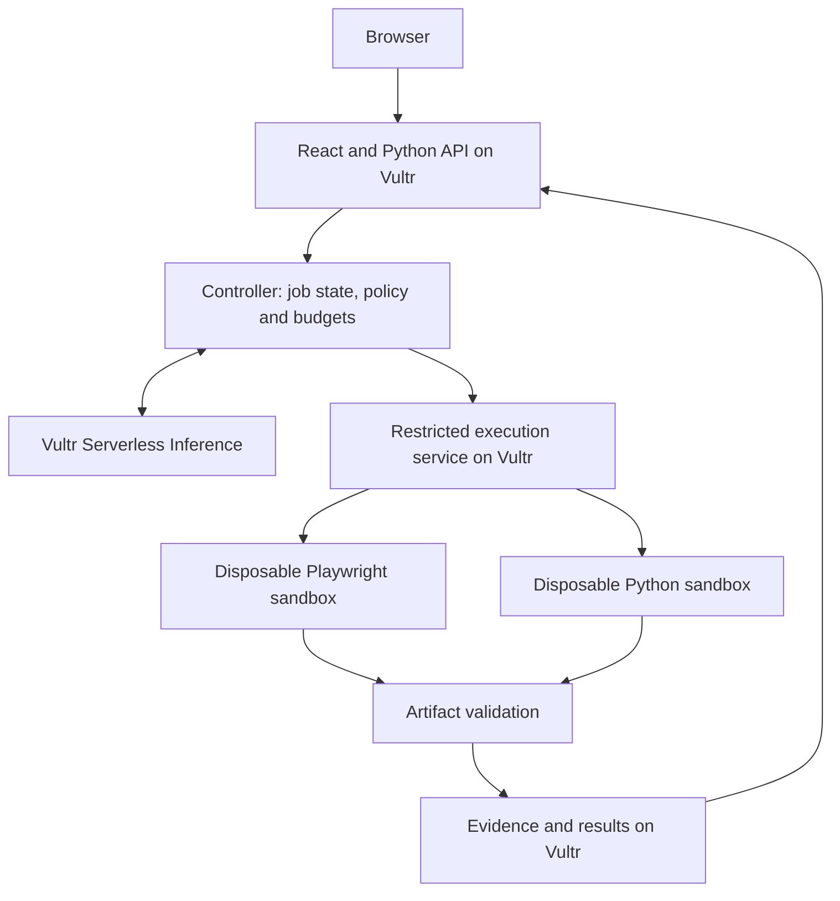

# SalesDesk

[](https://github.com/Jsjk112344/salesdesk/actions/workflows/ci.yml)

A proposed sales-engineering agent that researches prospects, executes small technical
demonstrations, and prepares outreach backed by inspectable evidence.

**Status: repository and local application scaffold.** Live research, sandbox execution,
model integration, outreach and Vultr deployment are not implemented. This is not yet
a complete hackathon entry. See [STATUS.md](STATUS.md).

## Vultr Agent Rush

Target: **Blast Radius Zero**, November 3–8, 2026.
The [official event](https://lablab.ai/ai-hackathons/vultr-hackathon) requires a public
repository, a Vultr-hosted web app/backend, isolated execution, Vultr agent inference,
and a video demonstrating containment. Submission is through LabLab.

Original project code is [MIT licensed](LICENSE). No proprietary application code or
private customer data is included. [Provenance](docs/provenance.md) records the baseline;
[THIRD_PARTY.md](THIRD_PARTY.md) covers dependencies.

## Product scope

A salesperson supplies an offer and a small prospect list. The planned workflow is:

1. Research public sources and distinguish facts from hypotheses.
2. Identify a relevant documented use case or report insufficient evidence.
3. Build a bounded document-extraction demonstration with permitted example inputs.
4. Execute it in isolation and validate the resulting artifacts.
5. Prepare a sourced outreach draft and exact-version review package.

The initial implementation will support one demonstration family. It will not imply
knowledge of a prospect's private infrastructure or financial savings.

## Local setup

Prerequisites: Python 3.12, [uv](https://docs.astral.sh/uv/), Node.js 24 and npm.
No API key or cloud account is needed for this scaffold.

```bash
git clone https://github.com/Jsjk112344/salesdesk.git
cd salesdesk
uv sync --locked
npm --prefix frontend ci
```

Terminal 1, from the repository root:

```bash
uv run uvicorn app.main:app --app-dir backend --host 127.0.0.1 --port 8000
```

Terminal 2:

```bash
npm --prefix frontend run dev
```

Open http://127.0.0.1:5173. The bootstrap screen checks `/api/health` through the
Vite development proxy. API documentation is at http://127.0.0.1:8000/docs.
The [environment example](.env.example) contains empty placeholders for future
server-side configuration; the current scaffold does not read it or make model calls.

## Checks

```bash
uv run ruff check backend scripts
uv run ruff format --check backend scripts
uv run python -m compileall -q backend
npm --prefix frontend run build
python3 scripts/check_repository.py
```

These check the scaffold, not agent quality, security containment or deployment.
The GitHub workflow runs the same checks without credentials or paid services.

## How Vultr will power SalesDesk

**Planned architecture, not deployed infrastructure:**



Cloud Compute will host the web app, API, controller and execution service. Serverless
Inference will provide every runtime agent model call through
`https://api.vultrinference.com/v1`, including planning, code generation, review and
outreach drafting. Model selection requires task-specific evaluation.

The controller will retain credentials. Sandboxes will receive limited inputs, enforce
resource/network limits, and be destroyed after tasks. Any model-dependent sample work
will use controlled controller operations, never API keys inside the sandbox.
PostgreSQL and artifact storage on Vultr are planned for saved work.

See [architecture](docs/architecture.md), [security boundaries](SECURITY.md),
[deployment plan](infra/README.md), [acceptance criteria](docs/acceptance.md), and the
[submission checklist](docs/hackathon.md). Public demo, video and slides are pending.
