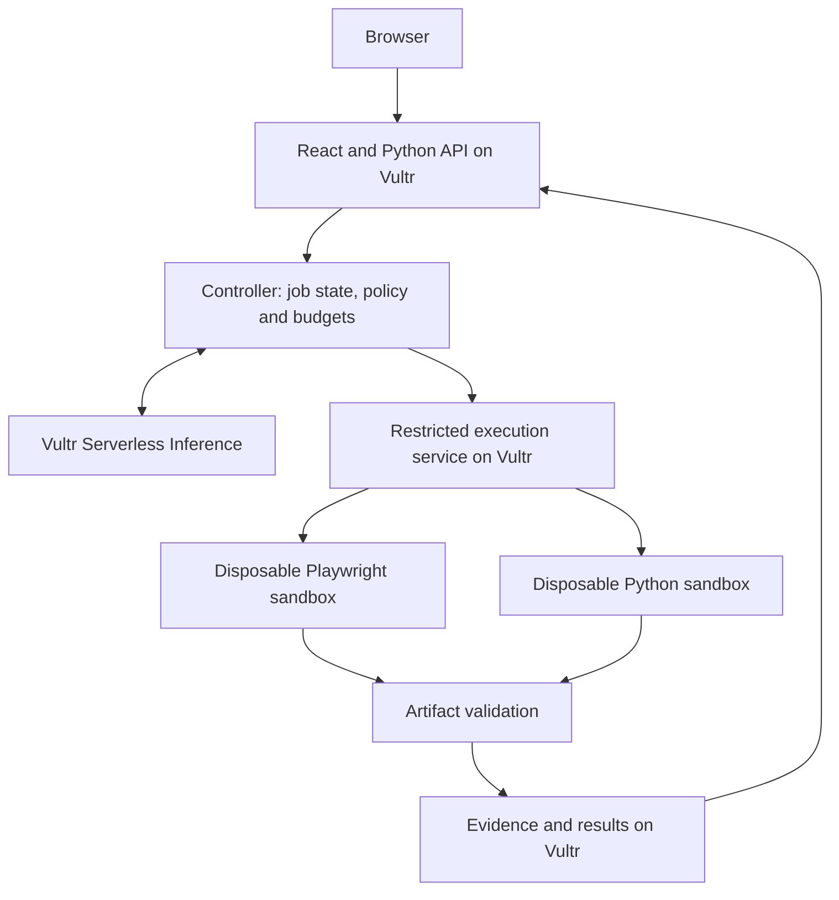

# ProofDesk

[](https://github.com/Jsjk112344/proofdesk/actions/workflows/ci.yml)

A proposed sales-engineering agent that researches prospects, executes small technical
demonstrations, and prepares outreach backed by inspectable evidence.

**Status: local execution slice plus application scaffold.** A CLI runs deterministic
synthetic Python tasks in disposable Docker containers, validates artifacts, and saves
execution records. Live research, model integration, outreach and Vultr deployment are
not implemented. This is not an autonomous agent or a complete hackathon entry.
See [STATUS.md](STATUS.md).

## Vultr Agent Rush

Target: **Blast Radius Zero**, November 3–8, 2026.
The [official event](https://lablab.ai/ai-hackathons/vultr-hackathon) requires a public
repository, a Vultr-hosted web app/backend, isolated execution, Vultr agent inference,
and a video demonstrating containment. Submission is through LabLab.

Original project code is [MIT licensed](LICENSE). No proprietary application code or
private customer data is included. [Provenance](docs/provenance.md) records the baseline;
[THIRD_PARTY.md](THIRD_PARTY.md) covers dependencies.

## Product scope

A salesperson supplies an offer and a small prospect list. The planned workflow is:

1. Research public sources and distinguish facts from hypotheses.
2. Identify a relevant documented use case or report insufficient evidence.
3. Build a bounded document-extraction demonstration with permitted example inputs.
4. Execute it in isolation and validate the resulting artifacts.
5. Prepare a sourced outreach draft and exact-version review package.

The initial implementation will support one demonstration family. It will not imply
knowledge of a prospect's private infrastructure or financial savings.

## Local setup

Prerequisites: Python 3.12, [uv](https://docs.astral.sh/uv/), Node.js 24 and npm.
No API key or cloud account is needed for this scaffold.

```bash
git clone https://github.com/Jsjk112344/proofdesk.git
cd proofdesk
uv sync --locked
npm --prefix frontend ci
```

## Local execution

Requires macOS/Linux, Python 3.12 and a trusted local Linux Docker daemon with cgroup v2
and default seccomp enabled. The controller needs Docker access; tasks never receive it.
Start Docker Desktop/Colima or Docker Engine, then run from the repository root:

```bash
docker info
docker pull "$(cat infra/task-image.txt)"
uv run python -m backend.app.execution run
```

The pinned official Python image is pulled explicitly; task execution never pulls images
or installs packages. No cloud resources, model calls or credentials are required.
The [original synthetic document](fixtures/extraction/document.txt) and
[deterministic script](fixtures/extraction/extract.py) produce
[this exact expected JSON](fixtures/extraction/expected.json), including a 1,600-cent total.
This demonstrates real local execution of fixture code, not generated code or model quality.

The command prints a JSON summary and the path to `.local/executions/<id>/record.json`.
Successful runs also save `result.json`. Records include input/script/expected hashes,
revision and dirty-tree status, Docker image identity, pre-task kernel limits, exit code,
failure reason, validated artifacts and verified container absence. Exact synthetic
inputs are saved alongside the record. See the [record contract](docs/execution-record.md)
and [JSON Schema](docs/execution-record.schema.json). Everything generated stays ignored
under `.local/`; no database or public execution endpoint exists.

Run the labelled fault-injection/containment probes:

```bash
uv run python -m backend.app.execution probe all
uv run python -m backend.app.execution probe timeout
uv run python -m backend.app.execution probe incorrect
```

`probe all` checks 15 cases, then runs a valid extraction again. A probe command returns
zero when its **expected** outcome and cleanup checks pass; individual execution records
still say `failed` for intentionally invalid tasks. Probes cover incorrect JSON, size and
output quotas, unsafe files, timeout, nonzero exit, memory exhaustion, blocked network and
host-file access, environment allowlisting, filesystem capacity and process count.
Network probes attempt TCP connections to a documentation address and the link-local
metadata address without sending application data. The host canary is synthetic.

Ctrl-C and SIGTERM trigger cleanup and an `interrupted` record. After SIGKILL, a controller
crash, or daemon failure, restore Docker and run:

```bash
uv run python -m backend.app.execution cleanup
```

Recovery removes only containers labelled for this checkout and reconciles unfinished
records. A checkout lock prevents concurrent controllers; new work refuses to start if
abandoned task containers remain. Keep the checkout at the same path until recovery.
Missing Docker, missing image, unsupported limits and failed cleanup are explicit failures;
there is no host execution fallback. See [actual boundaries and limitations](SECURITY.md).

## Development screen

Terminal 1, from the repository root:

```bash
uv run uvicorn app.main:app --app-dir backend --host 127.0.0.1 --port 8000
```

Terminal 2:

```bash
npm --prefix frontend run dev
```

Open http://127.0.0.1:5173. The bootstrap screen checks `/api/health` through the
Vite development proxy. API documentation is at http://127.0.0.1:8000/docs.
The [environment example](.env.example) contains empty placeholders for future
server-side configuration; the current scaffold does not read it or make model calls.

## Checks

```bash
uv run ruff check backend scripts
uv run ruff format --check backend scripts
uv run python -m compileall -q backend
uv run python -m unittest discover -s backend/tests -v
npm --prefix frontend run build
python3 scripts/check_repository.py
```

These check the scaffold and offline validation/missing-Docker behavior. Two Docker test
groups are skipped unless explicitly enabled. After pulling the image, run:

```bash
PROOFDESK_DOCKER_TESTS=1 uv run python -m unittest discover -s backend/tests -v
```

This additionally exercises actual containers, all probes, SIGINT/SIGTERM, forced-controller
crash recovery and a valid task after each interruption. The GitHub workflow runs the offline
checks without credentials, Docker image pulls or paid services. Local Docker observations
are not evidence of Vultr deployment, agent quality or protection against every escape.

## How Vultr will power ProofDesk

**Planned architecture, not deployed infrastructure:**



Cloud Compute will host the web app, API, controller and execution service. Serverless
Inference will provide every runtime agent model call through
`https://api.vultrinference.com/v1`, including planning, code generation, review and
outreach drafting. Model selection requires task-specific evaluation.

The controller will retain credentials. Sandboxes will receive limited inputs, enforce
resource/network limits, and be destroyed after tasks. Any model-dependent sample work
will use controlled controller operations, never API keys inside the sandbox.
PostgreSQL and artifact storage on Vultr are planned for saved work.

See [architecture](docs/architecture.md), [security boundaries](SECURITY.md),
[deployment plan](infra/README.md), [acceptance criteria](docs/acceptance.md), and the
[submission checklist](docs/hackathon.md). Public demo, video and slides are pending.
