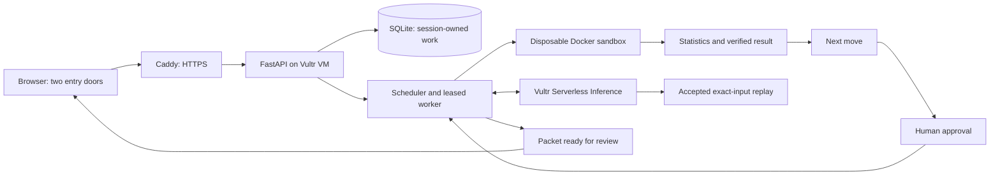

# SalesDesk

**Sell more: Your AI sales analyst.** SalesDesk measures what your last campaign actually
did, proposes your next move, and prepares it for your approval, on Vultr, with every
number verified. Start with a past campaign or research your first customers; both doors
lead to an analyst, a next move, your approval and work prepared while you are away.

**Demo:** [Open SalesDesk](https://salesdesk.149.28.51.139.sslip.io)

**Try it in 60 seconds:**

1. Open the demo and let the Vultr workers prepare your isolated example workspace.
2. Choose **Analyse a campaign**. Read the benchmark result and expand Analyst activity.
3. Scroll to **Next move**, add a note and **Save next move**, then **Approve & schedule**.
4. Close the tab. Return to **Ready for review** and download your Markdown packet.
5. Try **Starting from zero** for a sourced example brief and an unsent outreach draft.

A seeded example approval and ready packet are labelled as demo examples. Your edits need
a fresh approval. New analysis plans and prospects remain available within session limits.

[Source repository](https://github.com/Jsjk112344/salesdesk) ·
[Observed verification and spend](STATUS.md) · [Walkthrough](docs/demo-walkthrough.md)

## Architecture



## How Vultr powers SalesDesk

The existing **proofdesk-web** Ubuntu 24.04 VM in **EWR, New Jersey** hosts FastAPI,
the durable store, scheduler, worker subprocesses and Docker execution. Caddy terminates
HTTPS and proxies to loopback. Work continues when the browser closes.

**Vultr Serverless Inference** runs `qwen3.8-flash-next` with JSON-object output and
reasoning disabled. Analysis, research and outreach have passed live end to end. Identical
public requests prefer previously accepted responses, labelled **Analyst: Qwen 3.8 on Vultr Inference** with **cached response**
in the tooltip and Verification; new requests use the same primary label. Rule-based mode is separately labelled. Failures remain
visible, with no silent provider or rule-based substitution. See [inference](docs/inference.md).

The owner authorized up to $150 of hackathon credit for compute and inference. Measured
request accounting is in STATUS.md; token-cost estimates are distinct from account billing.
No new VM was provisioned for this refactor.

## Analyst design

**See what worked** measures a real historical e-mail campaign: a saved comparison,
Docker statistics, uncertainty, a reading and an editable next move. **Starting from zero**
researches a prospect, prepares a brief, decides whether the supported demonstration fits,
and drafts an introduction. Both share measure/research → next move → approval → worker
preparation → review.

The controller renders figures from validated metric references and preserves the model
contracts, sandbox limits, source checks and version-bound approvals. Analyst activity
shows saved worker events and receipts; details sit inside Verification disclosures.
The plan page follows Analyst activity, Result, Next move and the packet card, with Verification collapsed below.

## Setup

Prerequisites: Python 3.12, uv, Node.js 24, npm and Docker.

```bash
git clone https://github.com/Jsjk112344/salesdesk.git
cd salesdesk
uv sync --locked
npm --prefix frontend ci
docker pull "$(cat infra/task-image.txt)"
uv run python -m backend.app.experiments fetch
uv run python -m backend.app.experiments import
npm --prefix frontend run build
uv run uvicorn backend.app.main:app --host 127.0.0.1 --port 8000 --workers 1
```

Open http://127.0.0.1:8000. Local private mode works without inference credentials using
labelled rule-based readings. For frontend development use `npm --prefix frontend run dev`.
Keep one API worker because it owns the scheduler thread.

Live mode requires `VULTR_INFERENCE_API_KEY` and an operator budget plan through
`PROOFDESK_ANALYSIS_LIVE_PLAN` and `PROOFDESK_SALES_LIVE_PLAN`. Public mode uses `PROOFDESK_PUBLIC_DEMO=1` and selects Live by default. Configure credentials outside
the checkout/release; never put them in browser code. The example plan schema and ledger
semantics are in [docs/inference.md](docs/inference.md).

Existing `PROOFDESK_*` settings, service names and paths retain their identifiers for
compatibility with the project's former ProofDesk name. Records stay in ignored `.local/`.

### Checks

```bash
uv run ruff check backend scripts
uv run ruff format --check backend scripts
uv run python -m compileall -q backend
uv run python -m unittest discover -s backend/tests -v
PROOFDESK_DOCKER_TESTS=1 uv run python -m unittest discover -s backend/tests -v
npm --prefix frontend run build
python3 scripts/check_repository.py
uv run python -m scripts.check_experiment_journey --base-url http://127.0.0.1:8000 --output .local/journey.json
```

Browser interactions use a disposable container and an explicitly mocked API:

```bash
docker build -t proofdesk-ui-check - < infra/browser-test.Dockerfile
uv run python -m scripts.check_browser
```

[Architecture](docs/architecture.md) · [Deployment](infra/README.md) ·
[Public demo](docs/public-demo.md) · [Dataset and methods](docs/experiments.md)

## Limits and what is mocked

- The benchmark is the genuine 64,000-customer Hillstrom historical campaign. It is a
  retrospective analysis, not a newly run campaign. Raw rows remain ignored and unserved;
  charts show aggregates. See [THIRD_PARTY.md](THIRD_PARTY.md) for the dataset rights boundary.
- Public prospect pages and demonstration documents are labelled synthetic examples. The
  worker actually executes the demonstration in Docker. Private research supports public
  websites through the existing SSRF-protected fetcher.
- A saved replay is an accepted live response for identical request bytes, validated again.
  It has a cached-response secondary label and makes no fresh model request. Browser tests use separate mocks.
- A packet is preparation for human review. No campaign has been launched by SalesDesk and
  historical incremental spend is not SalesDesk revenue. Missing inputs remain visible.
- SalesDesk does not send e-mail, contact anyone or connect to a CRM.
  No Slack, upload or mailbox integration exists.
- Each anonymous public session has up to three plans, six runs, six tasks, three queued
  jobs, and three prospects. Seeding uses one plan/run/task/prospect and two jobs. Due times
  are bounded to the next day. Records are isolated by an HttpOnly session cookie.
- Video recording, PDF slide export and the LabLab submission itself are separate from
  these prepared assets. Nothing is submitted without a receipt.

## License

Original code is [MIT licensed](LICENSE). Dependencies and references are recorded in
[THIRD_PARTY.md](THIRD_PARTY.md); [provenance](docs/provenance.md) separates the original
baseline from hackathon additions. No private customer data or proprietary product code
is included. Challenge: [Powering the Future of Work, Vultr Agent Rush](https://lablab.build/ai-hackathons/vultr-hackathon).
