# SalesDesk dealer-group architecture

The product loop is **nightly review → store queue → exact-version approval → worker
handoff**, with a regional view for group leadership. The existing experiment/prospect
workspaces remain reachable at their old URLs and through `#/legacy`, unlinked from the
new sidebar. No customer message or vehicle transfer is executed.

```mermaid
flowchart LR
  Browser --> Caddy[Caddy HTTPS on Vultr]
  Caddy --> API[FastAPI: session capabilities]
  API --> DB[(SQLite: .local/dealer)]
  API --> Scheduler[API-process scheduler]
  Scheduler --> Children[24 leased child jobs / concurrency 6]
  Children --> Docker[Per-job disposable Docker sandboxes]
  Docker --> Check[Independent reconciliation]
  Check --> Qwen[Vultr Serverless Inference]
  Qwen --> Contract[rooftop_brief / group_brief]
  Contract --> Replay[Accepted exact-input replay]
  Contract --> Queue[Ranked drafts]
  Queue --> Approval[Human approves exact hash and version]
  Approval --> Handoff[Leased worker: drafts and CSV tasks]
  Handoff --> Downloads[Owner-scoped downloads]
```

## Components and paths

- `backend/app/dealer/ingestion.py`: UTF-8 CSV limits, header synonyms, typed values,
  bounded validation reports, cross-file references, templates and sample loading.
- `dealer/store.py`: extends the existing experiment Store in a separate database;
  retains transactions, owner checks, operation keys, job transitions and conditional leases.
  Dealer groups, import staging, follow-up versions and recurring schedules are separate tables.
- `dealer/jobs.py`: extends the existing scheduler; each worker process owns a claimed
  rooftop job. The parent waits durably until every child is terminal, then aggregates
  successes and records failures. Parent waiting does not consume a concurrency slot.
- `dealer/analysis_program.py`: fixed standard-library program, executed only by Docker.
  Compact indexed artifacts stay under the existing 16 KiB artifact limit; typed inputs
  stay under 1 MiB. Lead risk, matching, age, carrying cost, source and salesperson metrics
  are computed deterministically.
- `dealer/matching.py`: independent controller reconciliation of risk flags, top-three
  order/components, distance, counts, source denominators and costs; expansion resolves
  indices only against hash-bound input. Per-run clocks advance uploaded risk/age and
  shift synthetic timestamps together. This is verification code, not a host-execution fallback.
- `dealer/contracts.py` and `reasoning.py`: curated validated facts to Vultr, reference-only
  quantities, restrictive customer-message vocabulary, live receipts, bounded plans,
  a shared locked aggregate ledger, accepted replay and explicit provenance. Rejected
  response text never persists. A failed live brief stays failed.
- `dealer/handoff.py`: exact draft-version approval, human-only message editing, invalidation,
  worker assembly and spreadsheet-formula protection. Every download rechecks approval.
- `dealer/schedule.py`: America/Denver 2 AM recurrence on the server, normalized through
  DST, bounded by session lifetime and review quotas. Next due is computed after a run.
- `frontend/src/dealer.tsx`, `dealer-store.tsx`, `dealer.css`: group/map/live state, role
  switch, store queue, Maria drawer, approvals/downloads, schedule, CSV data and Verification.
  Polling reads actual saved job events and child results. No progress timer fabricates work.

## Isolation, persistence and recovery

Each child uses a namespace derived from the dealer store and durable job id. Siblings can
run concurrently while the runner still refuses abandoned containers in its own namespace.
Startup recovery removes only the corresponding labelled containers before lease recovery.
The old experiment runner retains its serial namespace and original behavior.

Every result write verifies a live lease, stores a hash-bound artifact and records an
intermediate outcome transactionally. A requeued worker can reuse that accepted artifact
without duplicating work. Late workers cannot write through an expired/replaced lease.
All original container policies remain: unprivileged UID, read-only root, no network,
no host/Docker socket mounts or credentials, 128 MiB, half CPU, process/output/file caps,
and cleanup before a result is accepted.

Session capabilities use HttpOnly/SameSite cookies. Reads and writes are owner-scoped;
JSON/CSV writes require the existing same-origin header/origin checks. CSVs stage in
ignored session-owned SQLite, never in fixtures or the model transport. Browser initialization
shares a single cookie bootstrap request. Public quotas cap sessions, reviews and handoffs.

## Metric definitions

Open leads exclude sold/lost. Cold is no contact for at least 72 hours; sold interest,
past-due appointments and unanswered leads add risk. Matches score make/model/trim/body,
year distance, color, budget, mileage, age and same-store availability; top candidates must
meet the model/score threshold and configured radius. In-transit units retain their status.

The stat strip's in-stock count uses each risk lead's best match. Aged matched units are
distinct across the group, considering top-three candidates. Source close rate uses sold
leads / all imported leads for that source; appointment rate uses open leads. Median first
response uses rows with an observed first-contact timestamp. Source comparisons are descriptive.

Floorplan is an entered flat daily assumption, default $8/unit/day. Recoverable gross sums
listed price minus cost over best risk-lead matches and can count the same unit for several
leads; it is not an expected sales value. Previous accepted reviews supply later deltas;
the initial sample has an actual prior-night input snapshot, separately sandboxed.

## Public replay and deployment

A fresh sample session can read a previously accepted full review without scheduling fake
jobs. Records identify it as a saved sample review. Run now always creates actual leased
work and Docker execution; identical model inputs reuse accepted revalidated responses.
Briefs show Qwen provenance, individual drafts distinguish Qwen, Template and Your edit.
Only curated top-lead facts reach inference; raw exports, notes and contact details do not.

Caddy and FastAPI run on the existing 2-CPU / nominal 4-GiB Vultr EWR VM. The service cap is
1.5 GiB for the controller and workers; Docker container limits are unchanged. Operator keys,
plans, ledgers, accepted responses and stores stay outside release archives. See
[deployment](../infra/README.md), [inference](inference.md) and [observed evidence](../STATUS.md).

The platform's job/contract/approval engine is reusable; automotive is the first vertical.
Live CRM/DMS integrations and outbound sending are not implemented or claimed.

## Store agent trace

Store tiles remain reachable while running. The expanded trace uses only that child's
events and accepted outputs. Analysis rows run together and complete together after
sandbox reconciliation; there are no synthetic stage delays. Search counts cover
available local and nearby sister-store cars, scored pairs count every at-risk lead
against those cars. Qwen follow-up counts exclude deterministic templates and edits.
The final row requires successful worker and brief completion. Replay provenance stays visible.

The v3 desktop composition supports a 1280×720 viewport: readable 13 px minimum
text, 15 px trace rows, compact cards and a collapsed map while a review runs.
Tile pulse/check animations follow actual job state and respect reduced motion.
The drawer shows the best match and SMS together; breakdown and alternatives are
expandable. These presentation changes do not change job, model or approval contracts.
