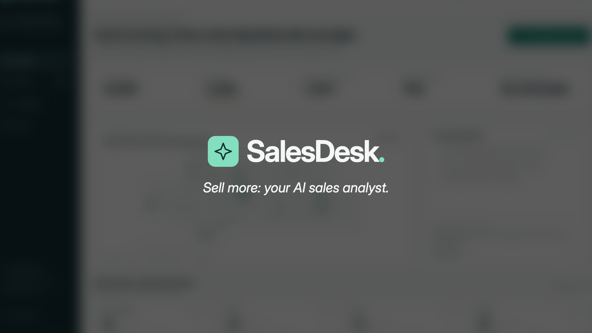
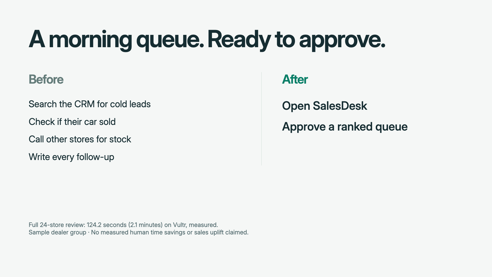
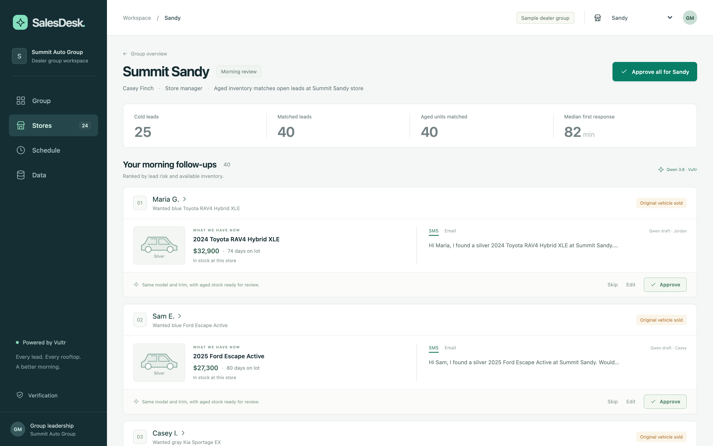
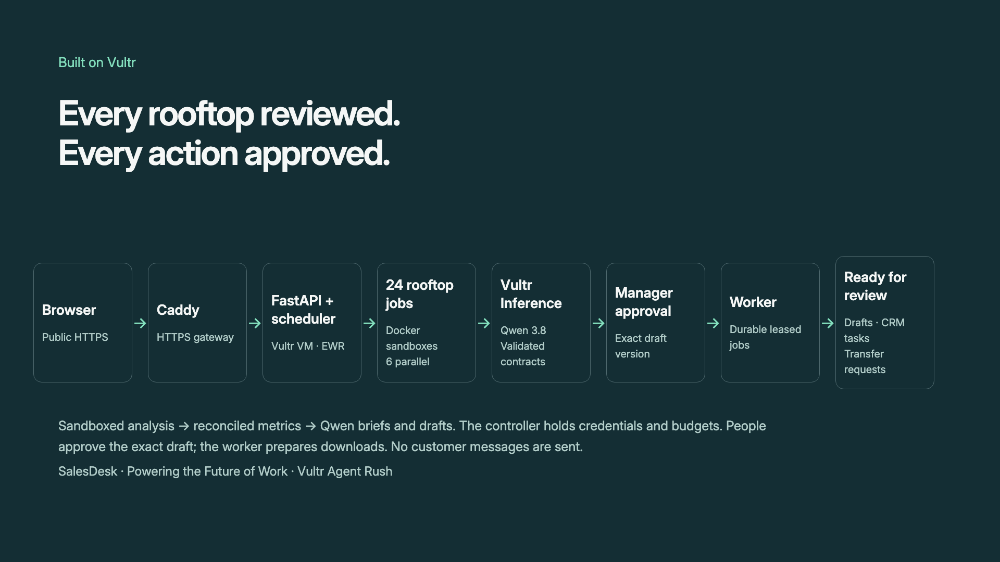
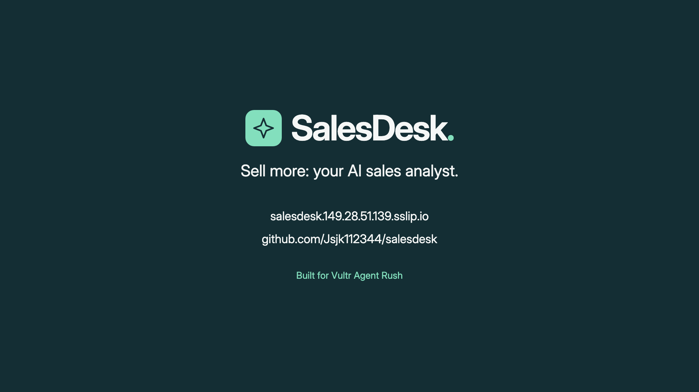

<!-- SalesDesk. Sell more: your AI sales analyst. -->

---

<!-- Actual recorded run time is printed on the card. No human time-saved ratio is claimed. -->

---

# Leadership sees the whole group.

9,000 reviewed · 1,050 at risk · 1,007 best matches in stock · 792 distinct aged units matched.
**$3,434,800 estimated recoverable gross**, from listed price minus cost; a unit can match
multiple leads. It is not a sales forecast. Sample dealer group; fictional people and data.

---

# Store managers get a ranked queue.

Sandy: **40 follow-ups**. Risk, available inventory and trade context together.
Store risk counts genuinely range 12–85 from varied synthetic records, with no queue cap.

---

# A fresh reason to follow up.

Maria G.: silver 2024 RAV4 Hybrid XLE, **74 days** on lot, **$32,900**, score **98**,
2017 Honda CR-V trade. Her original blue unit sold. The carrying-cost figure uses an
entered $8/unit/day assumption, not a measured lending expense.

---

<!-- Browser → Caddy HTTPS → FastAPI + scheduler on Vultr EWR VM → 24 rooftop jobs,
Docker sandboxes six at a time → Vultr Serverless Inference / Qwen → manager approval
→ durable worker → drafts, CRM tasks and transfer requests. -->

---

# AI drafts. People approve.

- CSV input today. Live CRM / DMS connections next.
- Exact-version approval; editing clears approval. Nothing is sent to customers.
- Accepted replay is revalidated and labelled; new inputs use bounded live inference.
- Complete live measurement: **25 responses / $0.0077789 token cost**, under one cent.
  Compute is separate; token-cost estimates are not billing receipts.
- The separate live run took **140.131 seconds** through final capture. The recorded
  take's own runtime appears on the jump-cut card and in `video/recorded-run.json`.

<!-- The original and video envelopes each remain bounded at $0.15 / 64 requests.
All existing ledgers, sandbox limits, validator rules and approval bindings are preserved. -->

---

<!-- SalesDesk. Public URL: https://salesdesk.149.28.51.139.sslip.io
MIT source: https://github.com/Jsjk112344/salesdesk
Built for Vultr Agent Rush, Powering the Future of Work. -->

<!-- Render this eight-slide deck using:
uv run python -m scripts.render_demo_assets
Add --capture to refresh real public app screenshots.
The renderer uses the same HTML geometry and PNG card visuals as the video.
Submission PDF: video/SalesDesk-slides.pdf
Exact visual source: video/SalesDesk-slides.html
Sources: video/measured-run.json, video/recorded-run.json,
video/inference-accounting.json, ../STATUS.md. -->
