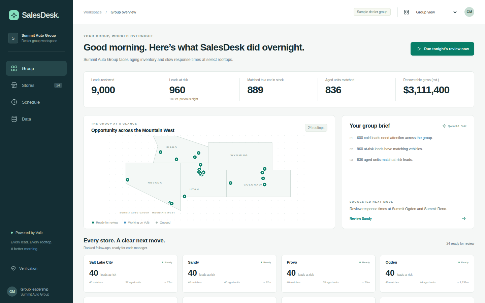
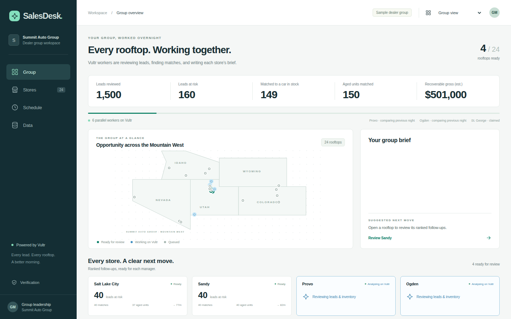
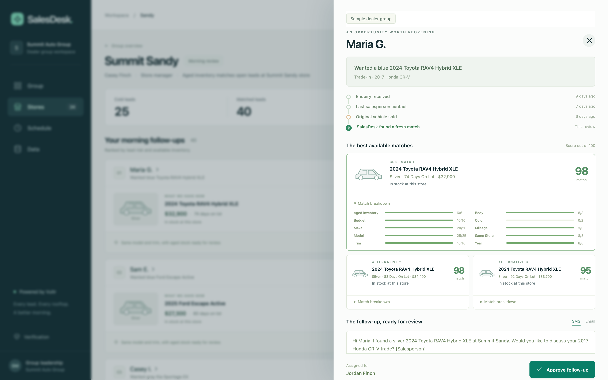

# SalesDesk

## Sell more: Your AI sales analyst.

Every night, it works every lead across every rooftop.

**Dealer-group GMs see the region. Store managers approve the morning queue.**

[Live demo](https://salesdesk.149.28.51.139.sslip.io)

---

# The manager’s morning starts with a search

Which leads went cold? Did the car sell? Is there a replacement at a sister store?
Which aged cars already match a buyer?

Group leadership needs visibility. Each store manager needs an action they can approve.

---

# Evidence: response quality and inventory both matter

- **19%** of dealers took over an hour to respond in DAS Technology’s 2025 study.
- **89%** did not offer an alternative available vehicle in the initial response.
- Study scope: **1,700** U.S. dealership website inquiries, Q3–Q4 2024; the sampled
  dealerships were not clients of DAS lead-response solutions.

Source: [DAS Technology, January 24, 2025](https://digitalairstrike.com/das-technology-unveils-comprehensive-automotive-dealership-lead-response-study-at-nada-2025/).
Vendor study; these figures are not SalesDesk outcomes or a universal conversion claim.

---

# Inventory ties up real capital

Lithia & Driveway reported **$228.2 million** of floorplan interest expense in 2025,
offset by **$168.5 million** of assistance, leaving **$59.7 million** of net vehicle
carrying costs. This is one dealer group’s reported expense, not an industry average.

Source: [Lithia 2025 Form 10-K, floorplan expense and assistance](https://www.sec.gov/Archives/edgar/data/1023128/000102312826000015/lad-20251231.htm).

Cox Automotive reported **43 days’ supply** of used inventory at the start of June 2025.
Market days’ supply measures stock relative to sales pace; it is **not** individual-car age.

Source: [Cox Automotive, June 13, 2025](https://www.coxautoinc.com/insights/used-vehicle-inventory-may-2025/).

---

# The cost of the problem, made inspectable

Our fictional sample: **24 stores · 3,000 vehicles · 9,000 open leads**.

The run found **600 cold leads**, **960 at-risk leads**, **889 best matches in stock**,
and **836 distinct aged units matched**.

**$3,111,400 estimated recoverable gross** = listed price minus cost over best risk-lead
matches. A car can match multiple leads. This is not a sales forecast or realized revenue.

Floorplan uses an **entered $8/unit/day assumption**, not a market interest-rate claim.
For Maria’s 74-day match, that is **$592** of illustrative carrying cost to date.

---

# One group. A clear next move at every store.

All numbers come from accepted job output. The sample and people are fictional.

---

# Watch the work happen on Vultr

24 leased rooftop jobs, six concurrent workers, separate disposable Docker sandboxes.
Counters and state changes follow actual saved child results.

---

# Maria’s original car sold. The opportunity remains.

Blue RAV4 enquiry → sold car → silver RAV4 Hybrid XLE, 74 days on lot →
SMS and email with her CR-V trade → manager approval.

---

# Before / after

| Before | After |
| --- | --- |
| Find cold leads, check stock, search sister stores, draft follow-ups | Review a ranked queue and approve exact drafts |
| Group leaders ask each store for the picture | Regional map, store ranking and validated roll-up |
| Preparation stops when the tab closes | Server-owned workers and recurring reviews |

**Measured public full run: 119.419 seconds.** Six concurrent child jobs; observed application
peak 641.59 MiB on the existing Vultr VM. [Release-specific observations](../STATUS.md).

Human triage time and business uplift have not been measured; no time-saved ratio is claimed.

---

# Vultr is the control plane

Browser → Caddy → FastAPI on Vultr VM → scheduler fan-out → parallel Docker sandboxes →
validated metrics → Vultr Serverless Inference → exact-version approvals → worker → downloads.

**VM:** 2 CPUs, nominal 4 GiB RAM, EWR/New Jersey. **Concurrency:** 6.
**Model:** qwen3.8-flash-next. JSON contracts; reasoning disabled.

Original sandbox, lease, budget, replay and session boundaries remain intact.

---

# AI drafts. People approve.

- Two validated contracts: rooftop brief and group brief.
- Model facts and quantities resolve through controller-rendered placeholders.
- Top-lead Qwen drafts, additional labelled templates, human edits tracked separately.
- Editing clears approval; preparation and downloads recheck the exact version.
- Accepted exact-input replay is revalidated and labelled. Rejections never execute or persist.

Nothing is sent to customers. Transfers are review requests, not executed moves.

---

# Cost, next, and the platform

The dealer inference envelope is **$0.15 / 64 requests**, inside the owner’s existing
$150 compute/inference authorization. Actual requests, usage estimates, uncertain rejected
calls and pessimistic reservations are itemized in [STATUS.md](../STATUS.md).

Current catalog rates checked November 6: **$0.10 input / $0.20 output per million tokens**.
[Official Vultr model catalog](https://api.vultrinference.com/v1/models/qwen3.8-flash-next).
Sample replays make no new inference request. VM billing is accounted separately.

**Next:** live CRM/DMS connections, production tenancy, refreshed source feeds and other verticals.
Current input is CSV; no named CRM/DMS integration is claimed.

---

# SalesDesk

**Every night, it works every lead across every rooftop.**

[Try the demo](https://salesdesk.149.28.51.139.sslip.io) ·
[MIT source](https://github.com/Jsjk112344/salesdesk)

Challenge 2: Powering the Future of Work · Vultr Agent Rush
