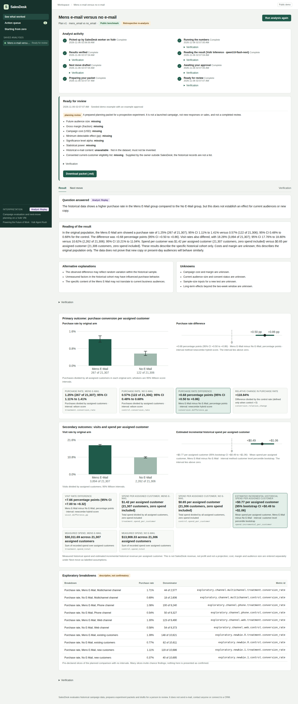

# SalesDesk: seven-slide deck

Prepared slide copy and visual directions. Export to PDF after inserting the current
public-demo screenshots; this Markdown is not a PDF submission artifact.

## 1. Problem and persona

**Sales managers have campaign reports. They still need a next move.**

A sales manager needs to understand whether a campaign helped, choose what to try next,
and keep preparation moving while the team is away from the dashboard.

Visual: a report on one side, an unprepared next-campaign brief on the other.

## 2. Evidence

**A real campaign, with a measurable historical effect.**

64,000 customers across the original three arms. Mens E-Mail versus No E-Mail:
267 / 21,307 purchases versus 122 / 21,306. Difference: +0.68 percentage points,
95% interval +0.50 to +0.86. Retrospective benchmark analysis, not SalesDesk-generated sales.

## 3. Cost

**A bounded analyst, on existing Vultr compute.**

Qwen 3.8 Flash Next: $0.10 input / $0.20 output per million tokens at the checked catalog
rates. Initial live validation: 13 request reservations, $0.0261248 worst case;
12 reported responses, $0.0039680 estimated usage cost. Replay avoids repeated inference
charges for identical requests. Compute billing is separate; no invented customer savings.

Visual: small request-cost table with a footnote to STATUS.md for final accounting.

## 4. Solution

**Sell more: Your AI sales analyst.**

SalesDesk measures the campaign, proposes your next move and prepares it for approval on Vultr.

## 5. Demo

**Run → understand → approve → walk away → review.**

Show Analyst activity, result chart, editable next move, Approve & schedule, then reopen
the ready packet. Brief cameo: Starting from zero prepares a prospect brief and unsent draft.

## 6. Before and after

| Before | With SalesDesk |
| --- | --- |
| A report to interpret separately | A campaign result with uncertainty and an analyst reading |
| Next steps in an unsaved conversation | Editable, versioned next move |
| Preparation depends on an open tab | Server-owned scheduled work |
| Unclear handoff | Ready packet with saved activity and download |

This is a workflow comparison. No measured time savings or new revenue claim is made.

## 7. Architecture on Vultr and what is next

Browser → Caddy HTTPS → FastAPI on the Vultr EWR VM → scheduler/worker → Docker sandbox.
Vultr Serverless Inference supplies Qwen 3.8 Flash Next; SQLite retains session-owned state,
approvals, events and packets. Accepted exact-input model responses can replay.

**Next:** bring your own campaign data and measure the next campaign in SalesDesk.

Visual: README Mermaid diagram. Footer: public URL, public GitHub repository, MIT license.
