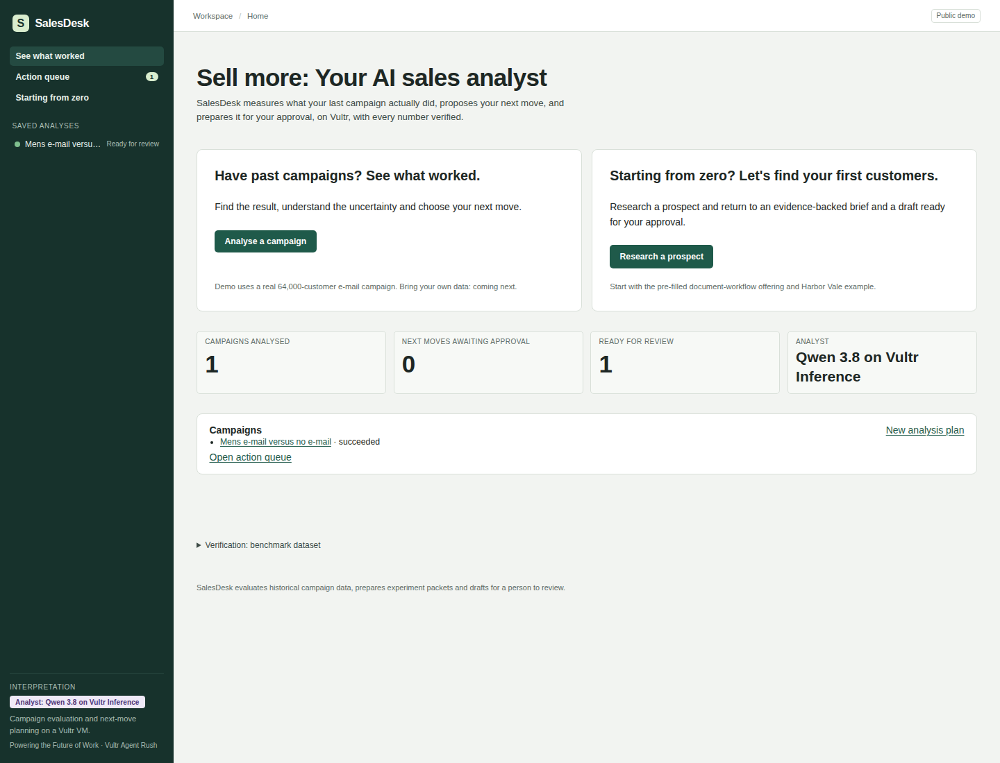
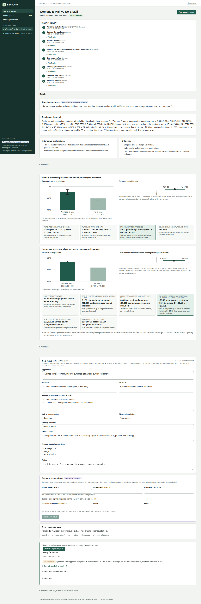

# SalesDesk: seven-slide deck

Prepared slide copy and visual directions. Export to PDF after inserting the current
public-demo screenshots; this Markdown is not a PDF submission artifact.

## 1. Problem and persona

**Sales managers have campaign reports. They still need a next move.**

A sales manager needs to understand whether a campaign helped, choose what to try next,
and keep preparation moving while the team is away from the dashboard.

Visual: a report on one side, an unprepared next-campaign brief on the other.

## 2. Evidence: sales teams lack capacity

**Sales teams have work to do and too little selling time.**

- Sales reps report spending **60% of their workweek on non-selling activities**.
  [Salesforce, State of Sales, seventh edition, p. 8](https://www.salesforce.com/en-us/wp-content/uploads/sites/4/documents/reports/sales/salesforce-state-of-sales-report-2026.pdf#page=8).
- **48% of reps say they lack bandwidth for adequate cold outreach**.
  [Salesforce's 2026 report announcement](https://www.salesforce.com/news/stories/state-of-sales-report-announcement-2026/).

Source context: vendor-published, double-anonymous survey of 4,050 sales professionals
in 22 countries, fielded August–September 2025. These are self-reported workload measures,
not a claim about how many campaigns go unmeasured.

Visual: two workload callouts with the source links visible.

## 3. Cost: preparation consumes sales capacity

**Preparation and planning take 16% of the average sales professional's time.**
[Salesforce, State of Sales, seventh edition, p. 21](https://www.salesforce.com/en-us/wp-content/uploads/sites/4/documents/reports/sales/salesforce-state-of-sales-report-2026.pdf#page=21).

For an illustrative team of ten people working forty hours each, that share represents
**64 team-hours each week**: ten × forty × 0.16. Team size and workweek are explicit
assumptions; this is an illustration of capacity cost, not observed SalesDesk savings.

SalesDesk turns campaign evidence into a reviewable next move and prepared handoff,
so the manager can decide what to do next in one saved workflow.

Visual: a team workweek with the preparation share marked, plus the arithmetic and source.

## 4. Solution

**Sell more: Your AI sales analyst.**

SalesDesk measures the campaign, proposes your next move and prepares it for approval on Vultr.

## 5. Demo

**Run → understand → approve → walk away → review.**

The demo uses the genuine Hillstrom campaign: 64,000 customers in its original three arms.
The seeded Mens E-Mail comparison recorded 267 / 21,307 purchases versus 122 / 21,306
for No E-Mail: +0.68 percentage points, 95% interval +0.50 to +0.86. This is a retrospective
benchmark result. During recording, create a fresh **Womens E-Mail vs No E-Mail** plan and
read its actual returned figures rather than narrating the seeded Mens result.

Show Analyst activity, result chart, editable next move, Approve & schedule, then reopen
the ready packet. Brief cameo: Starting from zero prepares a prospect brief and unsent draft.

## 6. Before and after

| Before | With SalesDesk |
| --- | --- |
| A report to interpret separately | A campaign result with uncertainty and an analyst reading |
| Next steps in an unsaved conversation | Editable, versioned next move |
| Preparation depends on an open tab | Server-owned scheduled work |
| Unclear handoff | Ready packet with saved activity and download |

**Measured in SalesDesk's own public run: 18.38 seconds from worker pickup to ready packet.**
Recorded November 6, 2026 UTC: 02:12:28.391082 → 02:12:46.768096. This run included Docker
analysis, a cached interpretation, a reproducibility rerun, scripted review/approval and a
scheduled wait. It excludes fresh inference latency and human deliberation. One observation,
not a customer time-saving claim. [Timestamp receipt and scope](workflow-measurement.json).

## 7. Architecture on Vultr and what is next

Browser → Caddy HTTPS → FastAPI on the Vultr EWR VM → scheduler/worker → Docker sandbox.
Vultr Serverless Inference supplies Qwen 3.8 Flash Next; SQLite retains session-owned state,
approvals, events and packets. Accepted exact-input model responses can replay.

**Low inference cost:** checked Qwen 3.8 Flash Next rates are $0.10 input / $0.20 output
per million tokens. Initial contract validation reserved $0.0261248 across 13 requests;
12 reported responses estimated $0.0039680 in token usage. Accepted exact-input replay
avoids another inference charge. Compute billing is separate. [Catalog source](https://api.vultrinference.com/v1/models/qwen3.8-flash-next)
and [updated accounting](../STATUS.md) distinguish reservations from usage and billing.

**Next:** bring your own campaign data and measure the next campaign in SalesDesk.

Visual: README Mermaid diagram. Footer: public URL, public GitHub repository, MIT license.
